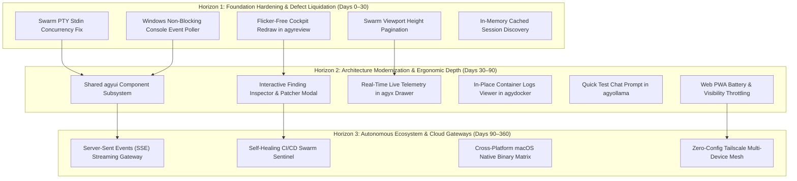

# Antigravity Product Roadmap & Complete Application Feature Catalog 🚀

**Target Workspace:** `C:\Users\TruongNhon\Documents\Powershell`  
**Document Type:** Strategic Product Roadmap & Full Program Feature Catalog  
**Standard:** 3-Horizon Evolution Model, 100-Point Quality Barème Impact, Evidence-Based Architecture  

---

## Part 1: Comprehensive Application & Feature Catalog

The Antigravity developer environment comprises **12 Go native micro-applications**, **2 Web Dashboards (SPA/PWA)**, and a **strongly typed PowerShell Profile engine**. Below is the comprehensive inventory of every program and its complete feature suite.

---

### 1. `agyx` — Master CLI Proxy & Unified Control Center
* **Binary:** `dist/windows/agyx.exe` / `bin/agyx`
* **Source Entry:** [apps/agyx/main.go](./apps/agyx/main.go#L1) (`file:///C:/Users/TruongNhon/Documents/Powershell/apps/agyx/main.go#L1`)
* **Cockpit UI:** [apps/agyx/internal/view/cockpit.go](./apps/agyx/internal/view/cockpit.go#L1)
* **Core Capabilities & Features:**
  1. **Unified Command Router:** Proxies and dynamically forwards commands to all 11 sub-tools (`agyx switch`, `agyx proj`, `agyx git`, `agyx docker`, `agyx port`, `agyx ollama`, `agyx term`, `agyx mobile`, `agyx bot`, `agyx swarm`, `agyx review`, `agyx aws`).
  2. **Interactive Master Cockpit (5 Tabs):**
     - Tab 1: 🛸 `Switch` — Account switching, live quota preview, fast launch.
     - Tab 2: 📁 `Proj` — Workspace registry, stack detection summary.
     - Tab 3: 🐙 `Git` — Multi-agent git fleet overview and dirty repo status.
     - Tab 4: 🐝 `Swarm` — Child terminal multi-PTY orchestrator preview.
     - Tab 5: 🛠️ `Tools Drawer` — Sub-cockpit drawer covering Docker, Ports, Ollama, Terminal, Mobile, Bot, AWS cheat sheet, and Code Review.
  3. **Direct Binary Resolution & Execution:** Automatically resolves native binaries from PATH, `./dist/windows/`, or `./bin/`.
  4. **Sub-Tool Fast Launch Shortcuts:** Press `[D]`, `[P]`, `[O]`, `[T]`, `[M]`, `[B]`, `[A]`, or `[V]` to launch sub-tools directly with restored terminal state.
  5. **Shell Wrapper Generation:** `agyx init` generates dynamic shell wrapper functions and completions for PowerShell and Bash/Zsh.

---

### 2. `agyswitch` — Identity, AES-256 Keyring Vault & Quota Engine
* **Binary:** `dist/windows/agyswitch.exe` / `bin/agyswitch`
* **Source Entry:** [apps/agyswitch/main.go](./apps/agyswitch/main.go#L1) (`file:///C:/Users/TruongNhon/Documents/Powershell/apps/agyswitch/main.go#L1`)
* **Cockpit UI:** [apps/agyswitch/internal/view/app.go](./apps/agyswitch/internal/view/app.go#L1)
* **Core Capabilities & Features:**
  1. **AES-256 Encrypted Token Vault:** Secures Google OAuth refresh and access tokens per account under `~/.gemini_<name>/keyring_token.txt` and Windows Credential Manager.
  2. **Isolated Environment Multiplexing:** Manipulates `$env:GEMINI_HOME` dynamically to isolate Antigravity conversation histories, cache, and preferences per Google identity.
  3. **Live CloudCode Quota Engine:** Asynchronously probes Google CloudCode quotas (Gemini 2.5 Flash, Gemini Pro, Claude 3.7 Sonnet) with remaining percentage meters.
  4. **Smart Auto-Quota Account Switching (`A` key / `agy-auto`):** Automatically switches to the account with the highest available model quota when limits are approached.
  5. **Skills Hub & Global Junction Sync (`S` key):** Scans and cross-links custom skills (`SKILL.md`) across all account contexts via Windows NTFS directory junctions.
  6. **Rules & MCP Manager (Tab 3):** Discovers, parses, previews, edits, and creates workspace rules and Model Context Protocol (MCP) server configurations.
  7. **Conversation Trajectory & Cost Analytics (Tab 4):**
     - Discovers transcripts (`transcript.jsonl`) across all accounts and workspaces.
     - Computes token counts, execution step trajectories, and estimated API costs in USD ($).
     - Resumes sessions directly (`Enter`), views step-by-step logs (`V`), opens code in VS Code (`W`), or deletes sessions (`D`).
     - Dual view modes: Project-Grouped vs. Flat Chronological.
  8. **Tiered Account Reset Modal (`X` key):** Offers Safe Reset (cache wipe), Deep Reset (credentials + history wipe), or Full Factory Reset.
  9. **Template Account Seeder (`T` key):** Clones baseline rules and skills from `~/.gemini_template` into new account contexts.
  10. **REST Sidecar API Server (`agyswitch serve`):** Exposes `http://localhost:8080/api/v1/status` for external status polling.

---

### 3. `agyproj` — Workspace Registry, Stack Detector & IDE Launcher
* **Binary:** `dist/windows/agyproj.exe` / `bin/agyproj`
* **Source Entry:** [apps/agyproj/main.go](./apps/agyproj/main.go#L1) (`file:///C:/Users/TruongNhon/Documents/Powershell/apps/agyproj/main.go#L1`)
* **Cockpit UI:** [apps/agyproj/internal/view/app.go](./apps/agyproj/internal/view/app.go#L1)
* **Core Capabilities & Features:**
  1. **Workspace Directory Registry:** Persistent registry stored at `~/.config/antigravity/projects.json`.
  2. **Automatic Tech Stack Fingerprinting:** Detects project technologies automatically (.NET 8/9, React, Next.js, Go, Python, Rust, Docker, Node.js).
  3. **Git Integration:** Displays active branch, tracking upstream, uncommitted changes, and dirty state badges for every workspace.
  4. **Multi-IDE Launcher:** Launch workspaces into Visual Studio Code (`code`), Neovim (`nvim`), Visual Studio (`devenv`), or dedicated Antigravity CLI context.
  5. **Fast Fuzzy Search (`/` key):** Instant real-time filtering across workspace names, file paths, stacks, and Git branches.
  6. **Automated Directory Scanner (Tab 2):** Recursively discovers unregistered Git repositories under `~/projects` or custom scan roots.
  7. **Quick Shell Transitions (`proj <name>`):** PowerShell profile bridge for immediate directory jumping.

---

### 4. `agygit` — Git Fleet Cockpit, Multi-Agent Worktrees & Staging
* **Binary:** `dist/windows/agygit.exe` / `bin/agygit`
* **Source Entry:** [apps/agygit/main.go](./apps/agygit/main.go#L1) (`file:///C:/Users/TruongNhon/Documents/Powershell/apps/agygit/main.go#L1`)
* **Cockpit UI:** [apps/agygit/internal/view/app.go](./apps/agygit/internal/view/app.go#L1)
* **Core Capabilities & Features:**
  1. **Interactive Staging & Commit Studio (Tab 1):**
     - Granular file-by-file staging/unstaging (`Space` key).
     - Diff viewer modal for unstaged and staged changes (`V` key).
     - Interactive commit wizard with Conventional Commits tags (`feat`, `fix`, `refactor`, `docs`) via `[C]`.
     - Non-destructive Soft Reset & Undo Commit wizard (`U` key).
     - Discard file changes (`X` key) and Untracked file cleanup.
  2. **Dual-Mode Commit History & Graph (Tab 2):**
     - Paginated commit table view with hash, author, relative time, and commit message.
     - ASCII Git Tree visualization (`G` key) rendering merge topologies and branch forks.
  3. **Branch & Rebase Operations (Tab 3):**
     - Branch switcher, creation, checkout, and deletion.
     - Push (`P`), Force Push (`F`), Pull/Sync (`L`), Fetch all remotes (`A`).
  4. **Parallel Multi-Agent Worktrees (Tab 4):**
     - Manages git worktrees under `.worktrees/<branch>` for parallel agent isolation.
     - Prevents index locking and working tree conflicts when multiple subagents work on different tasks simultaneously.
     - Add, prune, and jump into dedicated worktree directories.
  5. **Multi-Repo Fleet Monitor (Tab 5):**
     - Scans all repositories across the developer machine.
     - Summarizes fleet health: clean vs. dirty status, unpushed commits, unmerged branches.

---

### 5. `agydocker` — Container Fleet & WSL2 Kernel RAM/Swap Guard
* **Binary:** `dist/windows/agydocker.exe` / `bin/agydocker`
* **Source Entry:** [apps/agydocker/main.go](./apps/agydocker/main.go#L1) (`file:///C:/Users/TruongNhon/Documents/Powershell/apps/agydocker/main.go#L1`)
* **Cockpit UI:** [apps/agydocker/internal/view/app.go](./apps/agydocker/internal/view/app.go#L1), [devtools_tab.go](./apps/agydocker/internal/view/devtools_tab.go#L1)
* **Core Capabilities & Features:**
  1. **Container Fleet Management (Tab 1):**
     - Live container list with port mappings, status, uptime, and image names.
     - Dual layout: Grouped by Docker Compose Project vs. Flat List (`G` key).
     - Single-keystroke container lifecycle actions: Start (`S`), Stop (`T`), Restart (`R`), Remove (`D`).
     - Compose stack bulk down/stop (`X` key).
  2. **WSL2 Kernel RAM & Swap Guard (Tab 2):**
     - Reads `/proc/meminfo` directly from WSL2 Linux kernel.
     - Displays live RAM used, total, percentage, buffer/cache, and Swap utilization.
     - One-click memory reclaim: Drops Linux page caches, dentries, and inodes via `echo 3 > /proc/sys/vm/drop_caches`.
  3. **Volume & Cache Pruning (Tab 3):**
     - Lists dangling and in-use Docker volumes with disk space utilization.
     - Prunes dangling volumes and build cache (`P` key).
  4. **Dev Tools & Database Stack Orchestrator (Tab 4):**
     - Orchestrates pre-configured local developer service containers (PostgreSQL, Redis, RabbitMQ, MongoDB, MinIO).
     - Individual service start/stop/restart with auto port conflict detection.

---

### 6. `agyport` — Active Network Port Manager, Process Killer & Web UI
* **Binary:** `dist/windows/agyport.exe` / `bin/agyport`
* **Source Entry:** [apps/agyport/main.go](./apps/agyport/main.go#L1) (`file:///C:/Users/TruongNhon/Documents/Powershell/apps/agyport/main.go#L1`)
* **Cockpit UI:** [apps/agyport/internal/view/tui.go](./apps/agyport/internal/view/tui.go#L1)
* **Web UI Dashboard:** [apps/agyport/internal/web/server.go](./apps/agyport/internal/web/server.go#L1) (`http://127.0.0.1:5999`)
* **Core Capabilities & Features:**
  1. **High-Speed Socket Scanner:**
     - Identifies all active listening TCP/UDP sockets on Windows and Linux/WSL2.
     - Resolves PID, Process Name, Executable Path, and Command Line arguments.
     - Categorizes ports automatically: Frontend (3000, 5173), Backend (5000, 8080), Database (5432, 6379, 3306), AI (11434).
  2. **Selective & Bulk Process Termination:**
     - Kill process on selected port (`K` key).
     - Kill by Process ID (`P` key).
     - Bulk Kill All Dev Ports (`X` key / `agyport kill-all`): Closes lingering Vite, Next.js, Webpack, and Node servers in one pass.
  3. **Smart RAM Reclaim Engine (Tab 2):**
     - Detects idle and orphaned dev tool processes consuming RAM.
     - Generates intelligent memory reclaim recommendations.
     - Safe dry-run and live reclaim modes.
  4. **Process Inspector (Tab 3):**
     - Top 25 processes sorted by working set memory (MB).
  5. **Embedded Web UI Dashboard (`agyport ui` on `:5999`):**
     - Responsive HTML5/CSS3 web dashboard with auto-refresh polling (2.5s).
     - Search & filter by port, protocol, or process name.
     - Web buttons for individual kill, bulk kill, and RAM reclaim.
     - Auto-opens default web browser on launch.

---

### 7. `agyterm` — Windows Terminal Settings, Themes & Fonts
* **Binary:** `dist/windows/agyterm.exe` / `bin/agyterm`
* **Source Entry:** [apps/agyterm/main.go](./apps/agyterm/main.go#L1) (`file:///C:/Users/TruongNhon/Documents/Powershell/apps/agyterm/main.go#L1`)
* **Cockpit UI:** [apps/agyterm/internal/view/app.go](./apps/agyterm/internal/view/app.go#L1)
* **Core Capabilities & Features:**
  1. **Oh-My-Posh Theme Switcher (Tab 1):**
     - Discovers and previews 80+ Oh-My-Posh prompt themes.
     - Instant filter search (`/` key).
     - One-click theme application (`Enter` key) updating PowerShell and terminal profiles.
  2. **Windows Terminal `settings.json` Direct Mutator (Tab 2):**
     - Reads and modifies Windows Terminal configuration safely with JSON backup.
     - Inspects all WT profiles (PowerShell, Command Prompt, Ubuntu/WSL, Cloud Shell).
     - Cycles Nerd Fonts (`F` key): Cascadia Code NF, MesloLGS NF, Hack NF, FiraCode NF, JetBrainsMono NF.
     - Adjusts font size (`+`/`-`) and window background opacity (`[`/`]`).
  3. **Terminal Color Palette Viewer (Tab 3):**
     - Displays ANSI 16-color test grid and 256-color gradient blocks.
  4. **External CLI Tools Ecosystem (Tab 4):**
     - Audits installed developer CLI utilities (eza, fzf, zoxide, starship, bat, ripgrep, gh, lazygit).
     - Displays version, installation state, and documentation links.

---

### 8. `agymobile` — Mobile Smartphone TUI, Web PWA & Tailscale Station
* **Binary:** `dist/windows/agymobile.exe` / `bin/agymobile`
* **Source Entry:** [apps/agymobile/main.go](./apps/agymobile/main.go#L1) (`file:///C:/Users/TruongNhon/Documents/Powershell/apps/agymobile/main.go#L1`)
* **Cockpit UI:** [apps/agymobile/internal/view/app.go](./apps/agymobile/internal/view/app.go#L1)
* **Mobile Web PWA:** [apps/agymobile/internal/web/server.go](./apps/agymobile/internal/web/server.go#L1) (`http://<tailscale>:7890`)
* **Core Capabilities & Features:**
  1. **38-Column Narrow Smartphone TUI:**
     - Layout calibrated specifically for narrow mobile SSH clients (Termux, Prompt, JuiceSSH).
     - Displays host CPU/RAM, active AI profile, quota balance, running containers, and live agent step.
  2. **Tailscale & WireGuard Peer Discovery:**
     - Resolves Tailscale 100.x.x.x IPv4 address, MagicDNS name, and connected mobile peers.
     - Generates terminal QR Code (`agymobile qr`) for instant pairing from a smartphone camera.
  3. **Touch-Optimized Web PWA Dashboard (`:7890`):**
     - Responsive mobile card UI with CSS hardware acceleration and touch feedback.
     - Bearer Token authentication via URL parameter (`?token=...`) and `sessionStorage`.
     - Live progress bars for WSL2 RAM and Docker containers.
     - Action buttons: Flush WSL2 RAM (Drop Caches) and Stop All Containers.
     - Live Antigravity agent telemetry monitor.

---

### 9. `agyollama` — Local AI Daemon Cockpit & Open LLM Manager
* **Binary:** `dist/windows/agyollama.exe` / `bin/agyollama`
* **Source Entry:** [apps/agyollama/main.go](./apps/agyollama/main.go#L1) (`file:///C:/Users/TruongNhon/Documents/Powershell/apps/agyollama/main.go#L1`)
* **Cockpit UI:** [apps/agyollama/internal/view/app.go](./apps/agyollama/internal/view/app.go#L1)
* **Core Capabilities & Features:**
  1. **Ollama Daemon Lifecycle Control (Tab 1):**
     - Queries local endpoint (`http://127.0.0.1:11434/api/tags`).
     - Detects daemon status (Online, Offline, Port Conflict).
     - Start daemon (`S`), Stop daemon (`T`), Restart daemon (`R`).
  2. **Model Fleet Management (Tab 2):**
     - Lists all downloaded local LLM models (Llama 3, DeepSeek-R1, Mistral, Qwen, Phi-4).
     - Displays parameter size, quantization level (Q4_K_M, Q8), and modified timestamp.
     - Interactive Model Pull wizard (`P` key) with background download progress.
     - Model Detail Inspector modal (`V` key): Shows architecture, context length, license, and system prompt.
     - Model Deletion with safety confirmation (`D` key).
  3. **Hardware Benchmark Engine (Tab 3):**
     - Runs on-device token-per-second generation benchmarks (`B` key).
     - Records Prompt Eval Rate (tokens/s), Eval Rate (tokens/s), and Time-to-First-Token (TTFT) in milliseconds.
     - Benchmarks local GPU/VRAM performance across model sizes.
  4. **Daemon Logs & Diagnostics (Tab 4):**
     - Inspects local Ollama server log files with recent error tails.

---

### 10. `agybot` — Telegram Remote Controller & Project Daemon
* **Binary:** `dist/windows/agybot.exe` / `bin/agybot`
* **Source Entry:** [apps/agybot/main.go](./apps/agybot/main.go#L1) (`file:///C:/Users/TruongNhon/Documents/Powershell/apps/agybot/main.go#L1`)
* **Cockpit UI:** [apps/agybot/internal/view/tui.go](./apps/agybot/internal/view/tui.go#L1)
* **Core Capabilities & Features:**
  1. **Background Service Daemon:**
     - Runs headless as a background service via PID file (`~/.config/antigravity/agybot.pid`).
     - CLI commands: `agybot start`, `agybot stop`, `agybot restart`, `agybot status`, `agybot logs`.
  2. **Telegram Bot Remote Gateway:**
     - Connects securely to the official Telegram Bot API via long polling.
     - Executes Antigravity CLI commands and queries system status remotely from any mobile device.
  3. **Bank-Grade Security Guard:**
     - Whitelist of authorized Telegram User IDs (`ALLOWED_USER_IDS`).
     - Argon2/Bcrypt salted PIN verification (`/auth <pin>`).
     - Brute-force protection: Automatic account lockout after 3 failed attempts with exponential backoff.
     - Idle session auto-lock timeout.
  4. **Multi-Project Remote Runner:**
     - Switch active workspace remotely (`/workspace <name>`).
     - Run prompt queries and code review tasks against remote workspaces.
  5. **Interactive TUI Dashboard (5 Tabs):**
     - Tab 1: Overview & Daemon State.
     - Tab 2: Projects registry selector.
     - Tab 3: Configuration & token setup wizard (`T` key).
     - Tab 4: Real-time daemon log tail.
     - Tab 5: Active remote sessions and audit trail.

---

### 11. `agyswarm` — Multi-Agent Child Terminal Cockpit & PTY Orchestrator
* **Binary:** `dist/windows/agyswarm.exe` / `bin/agyswarm`
* **Source Entry:** [apps/agyswarm/main.go](./apps/agyswarm/main.go#L1) (`file:///C:/Users/TruongNhon/Documents/Powershell/apps/agyswarm/main.go#L1`)
* **Cockpit UI:** [apps/agyswarm/internal/view/cockpit.go](./apps/agyswarm/internal/view/cockpit.go#L1)
* **Core Capabilities & Features:**
  1. **Pseudo-Terminal (PTY) Process Multiplexing:**
     - Spawns and manages parallel subagent child terminal processes via native PTYs (`creack/pty` on Unix, ConPTY on Windows).
     - Dynamic split-pane terminal cockpit showing live terminal outputs of all running agents concurrently.
  2. **Automated Agent Status Heuristics:**
     - Evaluates agent terminal streams in real time.
     - `● WORKING` — Active CPU/PTY output streaming.
     - `⚡ NEED INPUT` — Heuristic detection of interactive CLI prompts, confirmation dialogs, or authentication queries.
     - `✔ DONE` — Clean exit code 0.
     - `✖ ERROR` — Non-zero exit code or fatal crash.
  3. **Direct Human Pass-Through Attachment:**
     - Press `[Enter]` or `[i]` to attach the physical keyboard directly to an agent child PTY.
     - Type input directly into the agent shell; press `Ctrl+]` to detach cleanly back to the Swarm Cockpit.
  4. **Multi-Account Agent Isolation:**
     - Assigns isolated Google identities/accounts to individual swarm workers (`--accounts a,b,c`).
  5. **Autonomous Multi-Agent Task Orchestrator (`agyswarm run`):**
     - Coordinates parallel agents to complete complex goals across multiple repositories.
  6. **Clean Markdown Dossier Export (`m` key):**
     - Strips ANSI color codes and exports complete agent transcripts into `./doc/swarm/*.md`.

---

### 12. `agyreview` — Autonomous Code Reviewer & Sentinel
* **Binary:** `dist/windows/agyreview.exe` / `bin/agyreview`
* **Source Entry:** [apps/agyreview/main.go](./apps/agyreview/main.go#L1) (`file:///C:/Users/TruongNhon/Documents/Powershell/apps/agyreview/main.go#L1`)
* **Cockpit UI:** [apps/agyreview/internal/view/cockpit.go](./apps/agyreview/internal/view/cockpit.go#L1)
* **Core Capabilities & Features:**
  1. **3-Loop Autonomous Headless Engine:**
     - Loop 1 (Fast Static Hygiene): Catches compile errors, trailing whitespace, dead code, missing docstrings.
     - Loop 2 (Deep Semantic Audit): Inspects race conditions, goroutine leaks, credential leakage, PTY closing.
     - Loop 3 (Self-Healing Remediation): Synthesizes findings, builds ready-to-apply diff patches, and calculates scores.
  2. **100-Point Quality Barème Index:**
     - Computes quantitative scorecard (0–100 pts) with Letter Grades (A+, A, B, C, D, F).
     - Deductions calculated strictly against `[P0]` (-20 pts), `[P1]` (-10 pts), `[P2]` (-4 pts), `[P3]` (-1 pt).
  3. **Strict Severity Rating Taxonomy:** Enforces `[P0 - CRITICAL]`, `[P1 - HIGH]`, `[P2 - MEDIUM]`, `[P3 - LOW]`, `[P4 - INFO]`.
  4. **Evidence-Based Markdown Deliverable Standard:**
     - Generates structured audit reports into `./doc/audit/<timestamp>_audit_review.md`.
     - Dual link references (VS Code relative and Windows local absolute paths).
     - Quoted offending code snippets and detailed failure explanations.
  5. **GitHub Pull Request Auditor (`agyreview pr <url>`):**
     - Fetches PR diffs via GitHub API, audits changes against rules, and formats PR comments.
  6. **Autonomous Task Remediation Engine (`agyreview fix`):**
     - Generates multi-horizon task remediation plans (`TASK_REMEDIATION_PLAN.md`).
     - Applies patches automatically (`internal/remediation/patcher.go`).
  7. **Product Roadmap Generator (`agyreview roadmap`):**
     - Translates code findings into actionable 3-horizon product roadmaps (`PRODUCT_ROADMAP.md`).
  8. **Git Watcher Sentinel (`agyreview watch`):**
     - Background daemon polling Git repositories for branch changes, commits, and pull requests to trigger instant audits.

---

### 13. PowerShell Modular Profile Engine
* **File:** [shell/windows/Microsoft.PowerShell_profile.ps1](./shell/windows/Microsoft.PowerShell_profile.ps1#L1) (`file:///C:/Users/TruongNhon/Documents/Powershell/shell/windows/Microsoft.PowerShell_profile.ps1#L1`)
* **Core Capabilities & Features:**
  1. **Zero-Latency Shell Bootloader:** Modular initialization with profile environment caching.
  2. **Smart Dynamic Aliases & Wrapper Generation:**
     - `agy-account use <name>` — Switch identity permanently.
     - `agy1`, `agy2`, `agy3` — Execute one-off commands under specific accounts without altering shell state.
     - `proj <name>` — Fuzzy jump to registered workspaces.
     - `dps`, `dstart`, `dstop`, `dprune` — Docker shortcut suite.
     - `gcm`, `gst`, `gco`, `gundo` — Git workflow enhancements.
  3. **PSReadLine Keybindings:**
     - `F7` — Interactive GUI command history selector (`Out-GridView`).
     - `Ctrl+Space` — Multi-line predictive IntelliSense completions.
  4. **Cross-Platform Parity:** Linux/WSL companion script [shell/linux/posh-profile.zsh](./shell/linux/posh-profile.zsh#L1) provides mirror aliases for Ubuntu and Zsh.
  5. **Enterprise Modules Integration:** Bundles `posh-git` (git prompt status), `Terminal-Icons` (glyph rendering), `z` (smart directory jumping), and `BurntToast` (Windows notifications).

---

## Part 2: Strategic Product Roadmap (3-Horizon Plan)

---

### Horizon 1: Foundation Hardening & Defect Liquidation (Immediate: Sprint 1–2 / 0–30 Days)

* **Objective:** Eliminate all P0/P1 stability, concurrency, and platform defects; achieve zero screen tearing and sub-15ms input latency.
* **Barème Score Target:** **74 (Grade C) ➔ 88 (Grade B)**

| Initiative ID | Milestone / Task | Target App | Severity Addressed | T-Shirt Size | Success Criteria |
| :--- | :--- | :--- | :---: | :---: | :--- |
| **H1.1** | **Swarm PTY Input Coordinator** | `agyswarm` | `[P0 - CRITICAL]` | **M** | 0 keystrokes stolen when attaching to child terminals; clean detachment via `Ctrl+]`. |
| **H1.2** | **Windows Console Event Poller** | `agydocker`, `agyswitch`, `agyport`, `agyollama` | `[P1 - HIGH]` | **M** | Smooth 60fps spinner animation during live quota and container polling; zero sleep input latency. |
| **H1.3** | **Swarm Viewport Windowing & Pagination** | `agyswarm` | `[P1 - HIGH]` | **S** | Viewport dynamically clamped to `(height - 8) / 6`; 0 terminal vertical buffer overflows with >5 agents. |
| **H1.4** | **In-Memory Session Discovery Optimization** | `agyswitch` | `[P2 - MEDIUM]` | **S** | Session filter cycling (`F` key) executes in <5ms without blocking disk I/O. |
| **H1.5** | **Flicker-Free In-Place Terminal Rendering** | `agyreview` | `[P2 - MEDIUM]` | **S** | Full-screen clear (`\033[2J`) restricted strictly to tab transitions; cursor homing on navigation. |

---

### Horizon 2: Architecture Modernization & Ergonomic Depth (Mid-Term: Month 1–3 / 30–90 Days)

* **Objective:** Expand interactive depth with in-place inspection modals, eliminate code duplication with a shared TUI kit, and integrate live telemetry across the master cockpit.
* **Barème Score Target:** **88 (Grade B) ➔ 95 (Grade A)**

| Initiative ID | Milestone / Task | Target App | Severity Addressed | T-Shirt Size | Success Criteria |
| :--- | :--- | :--- | :---: | :---: | :--- |
| **H2.1** | **Shared `agyui` Component Package** | Entire Suite | `[P3 - LOW]` | **L** | Unified box-drawing borders, color semantics, and keybinding listeners extracted into `apps/shared/agyui`. |
| **H2.2** | **Interactive Finding & Patch Remediation Modal** | `agyreview` | `[P2 - MEDIUM]` | **M** | Pressing `[Enter]` on a finding displays code diffs; `[A]` applies patch; `[W]` opens VS Code. |
| **H2.3** | **Live Telemetry in `agyx` Master Cockpit** | `agyx` | `[P3 - LOW]` | **M** | Live account quotas, project counts, dirty repos, and swarm agents rendered directly in master tabs. |
| **H2.4** | **In-Place Container Logs Modal** | `agydocker` | `[P3 - LOW]` | **S** | Pressing `[L]` opens a 50-line scrollable log tail modal without exiting the TUI. |
| **H2.5** | **Interactive Model Test Chat Prompt** | `agyollama` | `[P3 - LOW]` | **M** | Pressing `[C]` opens an in-terminal conversational test prompt streaming from local Ollama. |
| **H2.6** | **Web PWA Adaptive Visibility Polling** | `agymobile`, `agyport` | `[P3 - LOW]` | **S** | Polling drops from 3s to 30s when mobile screen is locked or browser tab is hidden. |

---

### Horizon 3: Strategic Capabilities & Autonomous Ecosystem (Long-Term: Quarter 2–4 / 90–360 Days)

* **Objective:** Transform the developer profile into an enterprise-grade autonomous developer mesh with cloud gateways and self-healing multi-agent swarms.
* **Barème Score Target:** **95 (Grade A) ➔ 99 (Grade A+)**

| Initiative ID | Milestone / Task | Target App | Impact Category | T-Shirt Size | Success Criteria |
| :--- | :--- | :--- | :--- | :---: | :--- |
| **H3.1** | **Server-Sent Events (SSE) Streaming Gateway** | `agymobile`, `agyport` | Real-Time Sync | **L** | Sub-50ms push updates for container stats and swarm outputs with 0 HTTP polling overhead. |
| **H3.2** | **Self-Healing CI/CD Swarm Sentinel** | `agyswarm`, `agyreview` | Autonomous QA | **XL** | Sentinel detects failing GitHub Actions, spawns isolated swarm agents in worktrees, and auto-submits remediation PRs. |
| **H3.3** | **Cross-Platform macOS Native Binary Matrix** | Entire Suite | Platform Reach | **L** | Automated cross-compilation for Darwin ARM64 (Apple Silicon) with homebrew tap distribution. |
| **H3.4** | **Zero-Config Tailscale Multi-Device Mesh** | `agymobile`, `agybot` | Remote Station | **M** | End-to-end encrypted peer-to-peer control over Tailscale without manual IP configuration. |

---

## Part 3: Immediate Next Steps & Tactical Execution Plan

To begin executing against Horizon 1 immediately:

1. **Sprint 1 Action (P0 Resolution):** Refactor [apps/agyswarm/internal/view/cockpit.go](./apps/agyswarm/internal/view/cockpit.go#L73) to pause the background stdin reader during `Manager.Attach()`.
2. **Sprint 1 Action (P1 Resolution):** Replace sleep-based `waitKey` in `poll_windows.go` across `agydocker`, `agyswitch`, `agyport`, and `agyollama` with `GetNumberOfConsoleInputEvents`.
3. **Sprint 2 Action (P1 Resolution):** Implement viewport pagination in `agyswarm` to clamp maximum visible panes to `(terminalHeight - 8) / 6`.

---
*Catalog and roadmap persisted at `./doc/PRODUCT_ROADMAP_AND_FEATURE_CATALOG.md`.*
